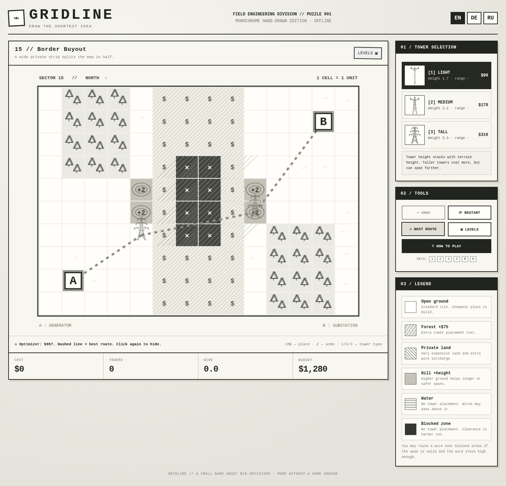

# GRIDLINE · Hand-drawn Power Line Puzzle

**GRIDLINE** is a lightweight, browser-based mathematical puzzle about routing overhead power lines through constrained terrain as cheaply as possible.



## Play

- Open [`index.html`](index.html) in any modern browser. The game runs entirely offline; no installation or build step is required.
- Choose **EN**, **DE**, or **RU** in the upper-right corner. **English is the default** on a new device; your choice is stored locally where supported.
- Select a tower (keys **1**, **2**, **3**) and click a buildable tile to add a tower. A straight connection is added from your last tower.
- Continue until you can connect to station **B**; then click **B** to complete the level.
- **Undo:** `Z` / `Backspace`. **Restart:** `R`. **Best route:** `H` or the *Best Route* button.

## Features

- **22 puzzles** with rivers, lakes, private land, forests, protected areas, and hills.
- Three distinctive, monochrome **hand-drawn tower types** with different heights and costs.
- Automatic wire-span checks (maximum span, simplified sag, terrain clearance).
- Cost optimization with private-land surcharges, a 1–3-star completion system, and local progress storage.
- **Dijkstra shortest-path solver** over a graph of possible tower positions/types, using the same cost and legality rules as the game. Click **Best Route** to compare your design with the solution found by the optimizer.
- Multilingual interface: **English / German / Russian**.
- Plain HTML, CSS and JavaScript; all images are embedded in `index.html`, so the one file is sufficient to play.

## GitHub Pages

1. Create a new GitHub repository (for example `gridline`).
2. Upload the **contents of this ZIP** to the repository root, keeping `index.html` at the top level.
3. Open **Settings → Pages**, select **Deploy from a branch**, `main` and `/ (root)`, then save.
4. GitHub will provide the public URL once the site is published.

You can also open `index.html` locally to play without publishing.

## Repository layout

```text
index.html              Complete standalone game
assets/
  preview.png           Gameplay preview
  tower_small.png       Small tower ink illustration
  tower_medium.png      Medium tower ink illustration
  tower_high.png        Large tower ink illustration
docs/
  GAME_DESIGN.md        Original Russian design notes
  GAME_DESIGN_EN.md     English game-design overview
README.md               This file
```

## How the puzzle works

The map is a **14 × 10 square grid**. Place towers and link them in order from **A** to **B**. Each valid connection has a cost determined by wire length and terrain. Each new tower adds tower and land costs. The game uses a deliberately simplified model of height, clearance and sag, which creates meaningful mathematical trade-offs without requiring a full electrical engineering simulation.

The built-in solver searches the discretized tower-state graph for a minimum-cost valid chain, and the star score compares the player's route with that result.

> **Not a real transmission-line engineering tool:** towers, clearances, construction costs and physics are intentionally fictional/game-balanced. Do not use them for professional design, safety analysis or construction.

## Technology

HTML5 Canvas · CSS · Vanilla JavaScript · Dijkstra shortest-path search · LocalStorage

No dependencies, frameworks, game engine, account or API keys required.

## Art

The three tower illustrations are original project assets in a monochrome hand-drawn style. Separate PNG assets are provided for reuse; the working game also contains them directly in the HTML file.

## Design documentation

See [`docs/GAME_DESIGN_EN.md`](docs/GAME_DESIGN_EN.md) for an English design overview and [`docs/GAME_DESIGN.md`](docs/GAME_DESIGN.md) for the original Russian notes.

## License

No license is included. Add the software and artwork licenses you want before accepting contributions or permitting reuse.
